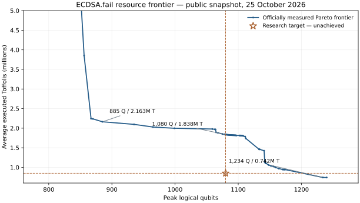

# ECDSA.fail sweet spot research

Research toward a secp256k1 point-addition circuit with **at most 1,080 peak logical qubits** and **at most 850,000 average executed Toffoli gates**. At the full width cap, the target scores 918,000,000 on ECDSA.fail's `Q × T` metric. To beat the current 915,281,246 record at exactly 1,080 qubits, it needs **at most 847,482 Toffolis**.

The stretch width is 1,050 logical qubits. At 850,000 Toffolis, a circuit of at most 1,076 qubits would beat the snapshot's global product record.

**Status (2026-10-25): target not achieved.** The repository contains a measured resource study, a coherence-safe TRSR design, and an exploratory width patch from the earlier 1,050-qubit search. It does not contain a validated 1,080 × 850,000 circuit or a full ECDSA attack.

Current development focuses on [asymmetric dataflow and algebraic provenance](docs/asymmetric-dataflow.md). The new frontend tracks stage ownership, input versions, field-expression origins, GF(2) bilinear rank lowering, and explicit phase-repair certificates. [Programmatic efficiencies](docs/programmatic-efficiencies.md) screens published techniques (Unqomp, caterpillar, Qrisp, AlphaTensor-Quantum, Qualtran, safegcd-bounds) and our rewrite rules against the leader's real 10.2M-op stream: no local rule fires, so the remaining levers are width-side algorithms. The [width audit](docs/width-audit.md) shows the leader's live state is information-dense (≤1 qubit from Clifford-only compression); width binds in three regions (divide walk, square, multiply walk), and a 1,080 record needs ≈687 T per qubit removed versus ≈7,100 for existing methods. Parameter-only width experiments are retained as historical evidence and are excluded from claims of architectural contribution.

## Measured reference points

| Circuit | Peak Q | Average T | Q × T | Evidence |
| --- | ---: | ---: | ---: | --- |
| Current global score leader | 1,234 | 741,719 | 915,281,246 | [official submission](https://api.ecdsa.fail/api/submissions/da097c38-3db4-4d6e-926b-98cec8026e98) |
| Lowest published T at Q ≤ 1,080 | 1,080 | 1,837,665 | 1,984,678,200 | [official submission](https://api.ecdsa.fail/api/submissions/07112bcc-26c3-449a-8f0a-b998ca92aa91) |
| Lowest published Q × T at Q ≤ 1,080 | 885 | 2,163,094 | 1,914,338,190 | [official submission](https://api.ecdsa.fail/api/submissions/d9e6ed49-3831-4ad2-803b-ae8a5c5106ef) |
| Lilypad 999-qubit reference | 999 | 1,998,018 | 1,996,019,982 | [official submission](https://api.ecdsa.fail/api/submissions/aee17ce0-0cbb-400f-bd42-0ebe29799799) |

The first line is globally promoted. The under-cap records have official measured metrics but were not promoted because their scalar scores did not beat the global leader. They passed the fixed 9,024-shot evaluator; that is not a proof of correctness on every possible input or measurement branch. These rows are a snapshot, not a live leaderboard.



Refresh the public API comparison with:

```bash
python3 scripts/frontier.py --max-qubits 1080 --target-toffoli 850000
```

## The design problem

Starting from the global leader, the target must save **154 peak logical qubits** while spending at most **108,281 additional Toffolis**. Its public source is [commit `644857a`](https://github.com/Layr-Labs/ecdsafail-challenge/commit/644857a), corresponding to the official 741,719-Toffoli record. A local build of that unchanged source reported `HEO_TOTAL ... peak=1234 peak_op=1184445 peak_phase=divide` and showed sustained forward-walk occupancy, not just one narrow spike: 1,097 active qubits at tick 1 and 1,197 at ticks 115–120, before carry scratch. See [the resource ledger](docs/resource-ledger.md).

The candidate architecture is [TRSR](docs/trsr.md): sparse linear stages, selective X-basis measurement with proved phase repair, and lifetime-aware register reuse. Teleportation is considered for *physical* routing and is accounted for separately from the challenge score. The immediate benchmark research question is whether a faster walk can reuse or recompute long-lived state for fewer than 108,281 extra Toffolis.

## Exploratory 1,050-qubit build

Applying [this one-line width patch](experiments/q1050-width.patch) to public submission [`f50ee00`](https://github.com/Layr-Labs/ecdsafail-challenge/commit/f50ee007fdf84054fa44b71240c28a66a47aad8e) lets its carry planner use 1,050 logical qubits. The local builder reported 1,970,565 expected Toffolis before postpasses and 1,966,959.5 after its existing truth and sparse Boolean passes. **The run was stopped before conditional cleanup and the independent evaluator. These are builder estimates, not a valid benchmark result.** This width-only retune is not presented as a substantive cross-account submission.

## Source and reproduction

The [challenge repository](https://github.com/Layr-Labs/ecdsafail-challenge) defines the evaluator, accepted edit surface, and metric. The [research paper](https://arxiv.org/abs/2609.09582) explains the point-addition scope and the limits of translating a point-addition score into a full Shor estimate. This repository credits the public submissions and contains no copied challenge implementation beyond the illustrative width diff.

This work has no official ECDSA.fail submission and has not been published to the challenge leaderboard.

The [circuit manifest](circuits/manifest.json) pins complete upstream source trees. Use [benchmark.sh](benchmark.sh) to reproduce them in a fresh directory. [analysis/peak_trace_1234.py](analysis/peak_trace_1234.py) extracts the live-qubit data from the leader's existing trace.

The [sparse recycling component](circuits/sparse_recycle.py) passes all 512 checked coherent measurement branches. Its exact local identity and prerequisites are documented in [TRSR](docs/trsr.md). [The experiment log](docs/experiment-log.md) records tested proposals and exclusions without promoting component tests into a full-circuit result.

The [provenance demonstration](architecture/demo.py) has useful coherent readers and reuses one scratch wire. Rank lowering reduces its preparation from five CCX gates to two; measured cleanup uses zero CCX. The actual emitted gates pass all 132 checked measurement branches. This is a small arithmetic component, with a full GF(p) backend and complete ECDSA integration still required.

The analysis scripts use Python's standard library. Rebuilding the figures with `python3 scripts/plot_resources.py` additionally requires Matplotlib; the rendered SVG and PNG figures are committed.

## Attribution

The measured circuit constructions belong to the credited public challenge contributors, including jackylee0424, gnuchev, gopikannappan, odinfree, jieyilong, BitWonka, mochimodev, zuiris, and the other upstream authors. Our exploratory width patch is derived from gnuchev's Q999 submission. The local resource study, TRSR accounting, and frontier tooling were prepared with Codex. See [NOTICE](NOTICE). This repository is licensed under Apache 2.0.
