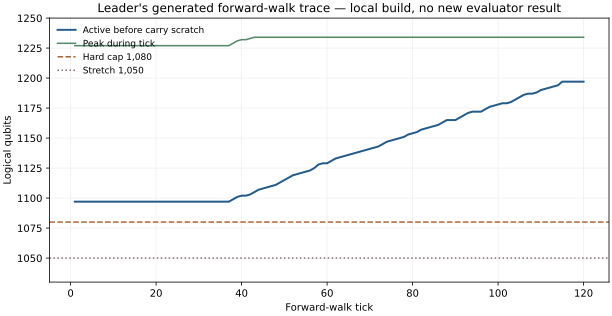

# Resource ledger and target arithmetic

Snapshot: 2026-10-25 UTC. Source: the unchanged public leader at [commit `644857a`](https://github.com/Layr-Labs/ecdsafail-challenge/commit/644857a), built locally with its `./benchmark.sh` up to the generated-circuit report. The later postpasses and independent evaluator were intentionally stopped because the official [submission](https://api.ecdsa.fail/api/submissions/da097c38-3db4-4d6e-926b-98cec8026e98) already supplies the validated final metrics. A builder report is evidence about the generated circuit, not a fresh local validation.

The builder reported:

```text
HEO_TOTAL native=780456 expected=741932.8 peak=1234 peak_op=1184445 peak_phase=divide qubits_touched=1234
```

The final official submission measured 741,719 average executed Toffolis at 1,234 peak logical qubits. The builder's expected count and the independent evaluator's executed average use different accounting and input samples. Do not substitute one for the other.

Selected forward-walk lines from the builder's `Y15_ROOM` trace:

| Tick | Active qubits before carry scratch | Room to 1,234 cap |
| ---: | ---: | ---: |
| 1 | 1,097 | 137 |
| 20 | 1,097 | 137 |
| 40 | 1,102 | 132 |
| 43 | 1,105 | 129 |
| 60 | 1,129 | 105 |
| 80 | 1,154 | 80 |
| 100 | 1,178 | 56 |
| 110 | 1,190 | 44 |
| 115–120 | 1,197 | 37 |

`Y16_PEAK` reaches 1,234 repeatedly starting at tick 43. At tick 115, the active state alone exceeds the new 1,080-qubit cap by 117; useful carry scratch requires still more room. This rules out a one-site peak shave as the complete width solution. It does not establish a lower bound on what a redesigned algorithm could do.



## Exact budget

Target `Q ≤ 1,080`, `T ≤ 850,000` gives `Q × T ≤ 918,000,000` at the full cap, 2,718,754 above the current official score of 915,281,246. A record at exactly 1,080 qubits requires `T ≤ 847,482`. Starting from the 1,234-qubit leader, the total Toffoli allowance increases by only `850,000 − 741,719 = 108,281` while peak width must fall by 154. The simple 1,050-qubit width experiment in this repository is roughly 1.967 million *expected* Toffolis, leaving more than 1.11 million to cut before the target.

## Next measured experiments

1. Instrument the live sets at the repeated `Y16_PEAK` sites: rails, field payloads, history, carry pool, and temporary products. Report each set's first and last read and the cost of regeneration.
2. Try a staged register alias or checkpoint schedule that removes at least 117 active qubits through late forward ticks, plus enough room for carry scratch. Measure the added Toffolis and watch for a new peak in the reverse walk.
3. Replace only provably erasable Boolean scratch with X-basis measurement and its exact phase repair. Measure Clifford count and classical control as well as Toffolis.
4. Rebuild and run the unmodified 9,024-shot evaluator, then check independent salted inputs and the forward–reverse identity. Record failures as failures; changing a nonce cannot make an approximate identity exact.

The ECDSA.fail score counts average executed Toffolis, **not Toffoli depth**. Physical routing, error-correction overhead, magic-state factory space, latency, and energy require a separate hardware estimate.
